# 执行前复核：界面流程

本附件用截图说明一个需要复核的任务在 Jenkins 上是怎样运行的：构建在任务执行前停下，把要执行的内容完整显示出来，有人点 **Run** 后才执行，点 **Abort** 则停止。机制、规则和证据见 BRIEF.md 的 3.10 节与 4.15 节；这里只讲界面。

截图来自测试用的本地 Jenkins 2.580.1（`tests/jenkins_server/server.py` 启动，界面语言为英文，没有开启登录，所以操作人显示为 `anonymous`），job 用 `pipelines/readwrite/Jenkinsfile`，任务是示例任务 `task_d`：它把参数 `task_d_items` 中逗号分隔的每一项写成复核文件的一行 `change <项>`，确认后按复核文件逐行输出 `applied change <项>`。

## 1. 发起构建

在 **Build with Parameters** 页面上勾选 `SKIP_DEPLOY`，在部署前任务中勾选 `task_d`，在随之出现的表单中填写 `task_d_items`，点 **Build**。用 API 触发时，`DEPLOY_PLAN` 写 `{skip_deploy: true, pre: [{name: task_d, params: {task_d_items: 'restart cache, rotate logs'}}]}`，效果相同。

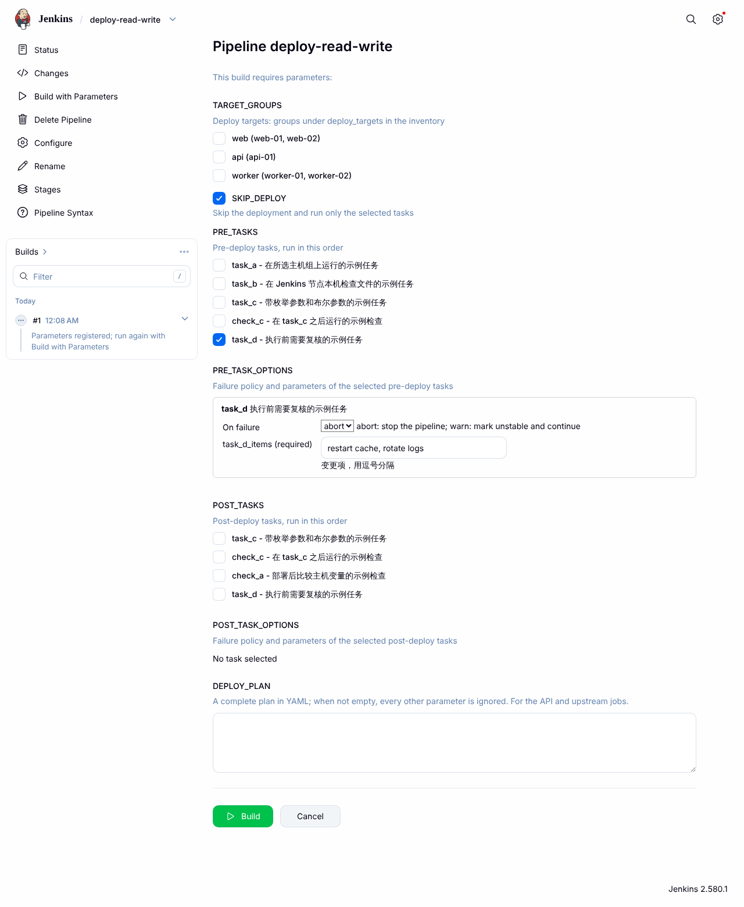

## 2. 构建停在复核

`task_d` 先以生成模式运行一次，写出复核文件，然后构建暂停。Stages 页面上 `pre: task_d` 显示暂停图标，右侧是复核提示和 **Run** / **Abort** 按钮：

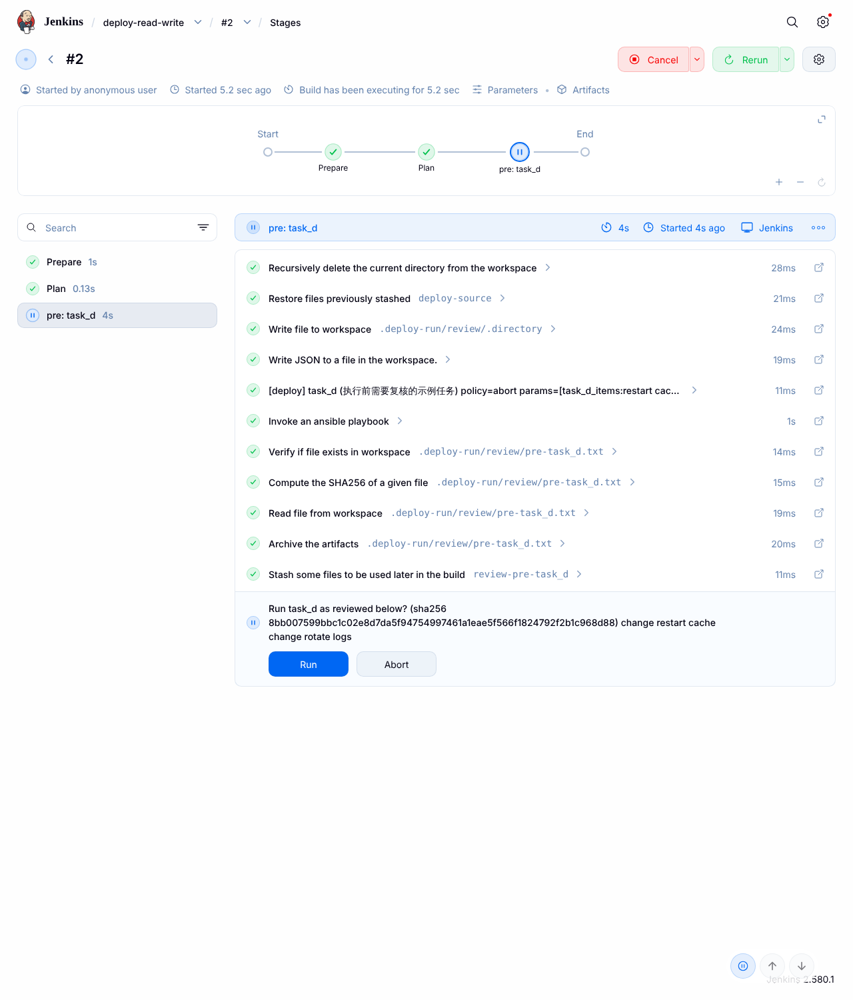

Stages 页面上的提示把换行折叠成了一行。控制台中是完整的提示：要执行的任务、复核文件的 sha256 和全文，换行保留，最后一行是 **Run or Abort** 两个链接。复核时看这里：

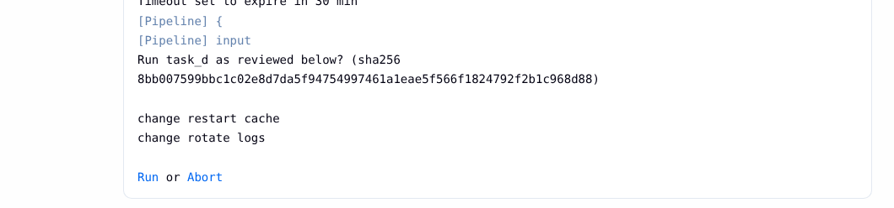

左侧菜单 **Paused for Input** 打开的页面同样把提示折叠成一行，长内容不便阅读：

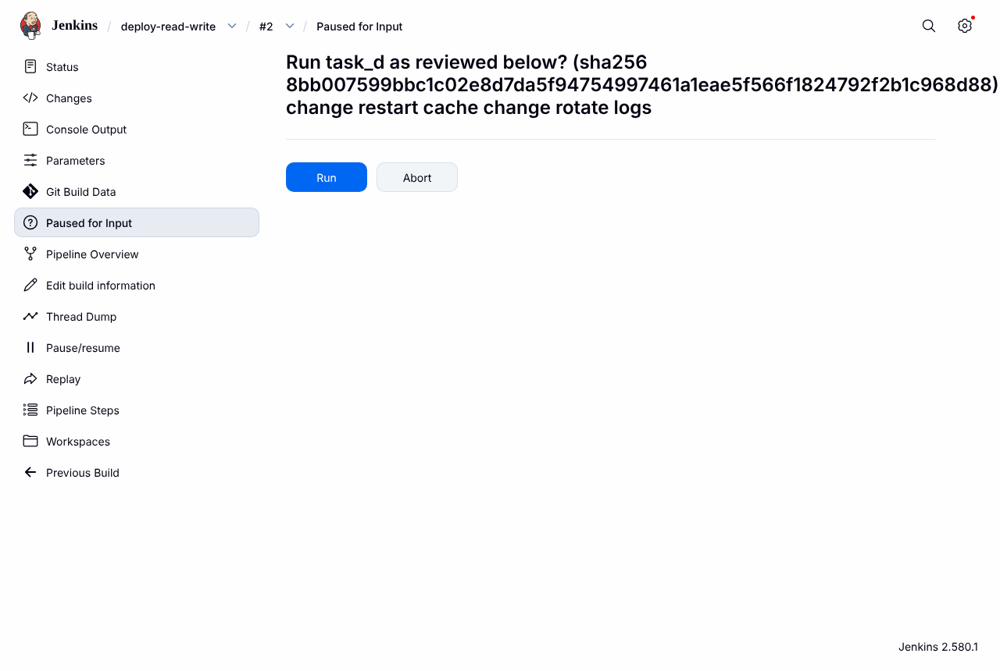

复核文件同时归档为构建产物 `.deploy-run/review/pre-task_d.txt`，可以单独打开或下载：

等待期间不占执行器：首页的 **Build Executor Status** 为 `0/2`。

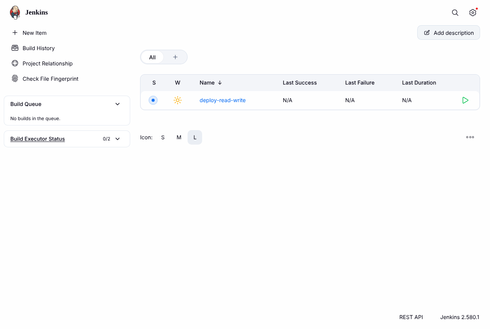

## 3. 点 Run：按复核文件执行

控制台依次显示 `Approved by anonymous`、`[deploy] task_d confirmed by anonymous`、`verifySha256`（复核文件与确认时的 sha256 一致），然后 `task_d` 以执行模式运行，逐行输出复核文件中的变更：

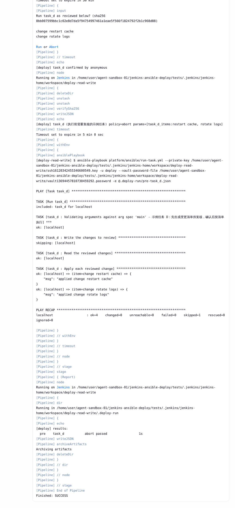

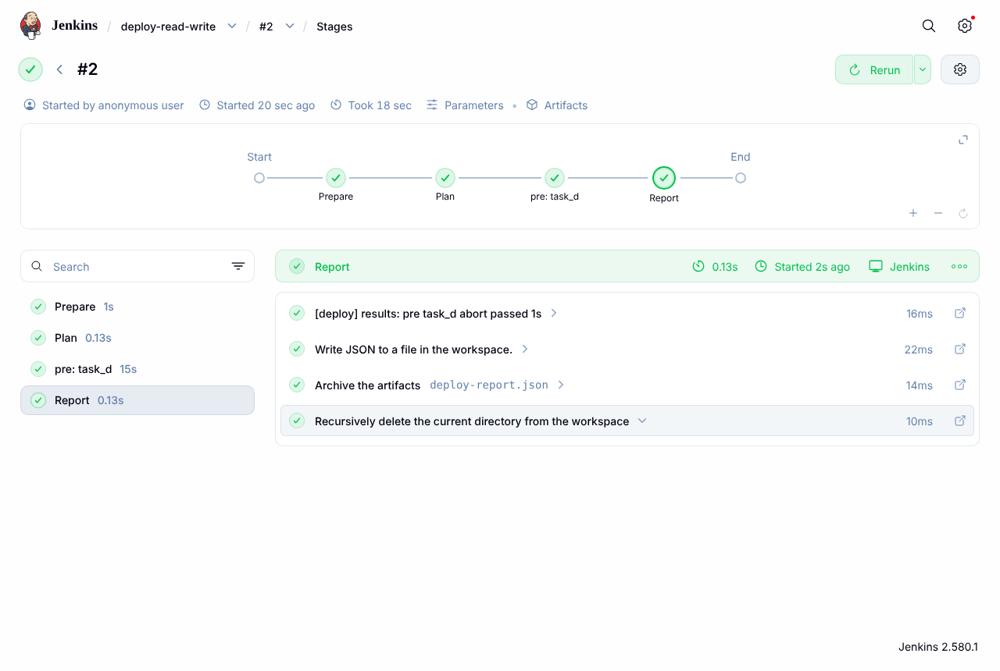

报告 `deploy-report.json` 中该任务的 `reviewer` 是确认人：

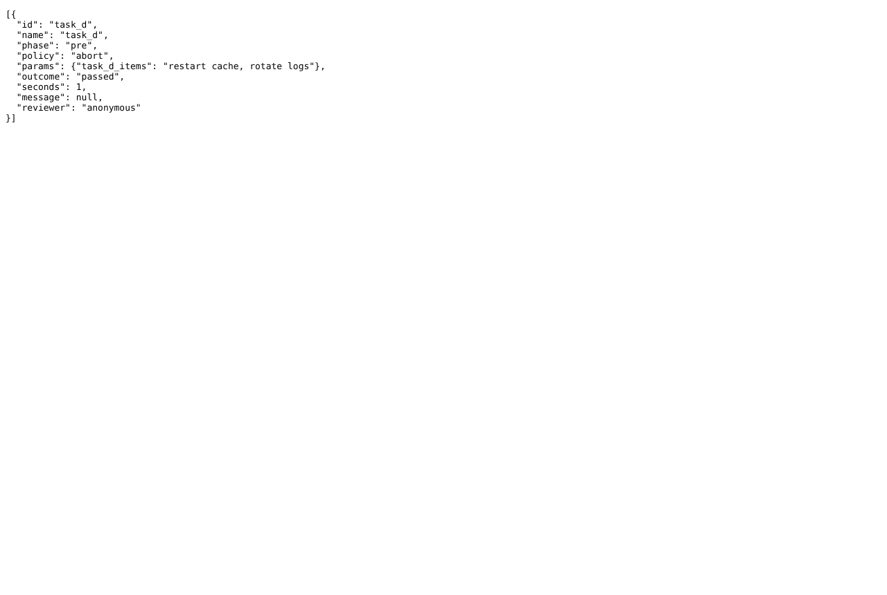

## 4. 点 Abort：不执行

构建 ABORTED，控制台中有 `Rejected by anonymous`，任务没有以执行模式运行，报告中该任务为 `aborted`、`not confirmed`。等待超过 `review.timeout_minutes` 时结果相同。

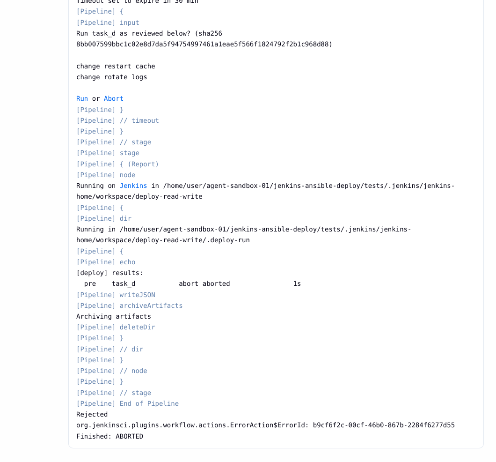

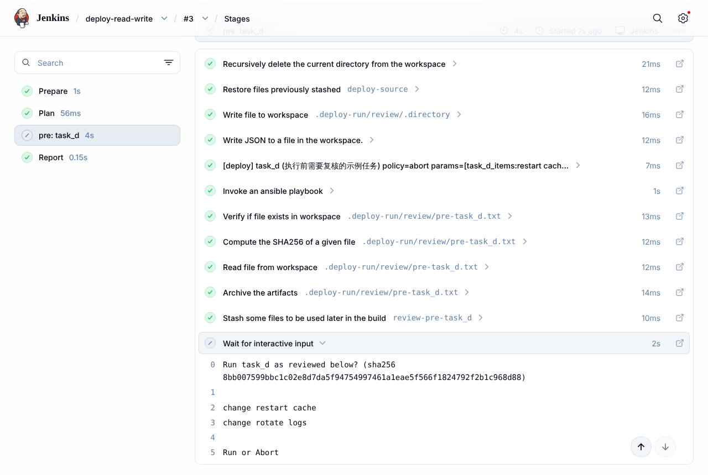

## 5. 构建历史

确认后执行成功的构建为绿色，中止或超时的为灰色：

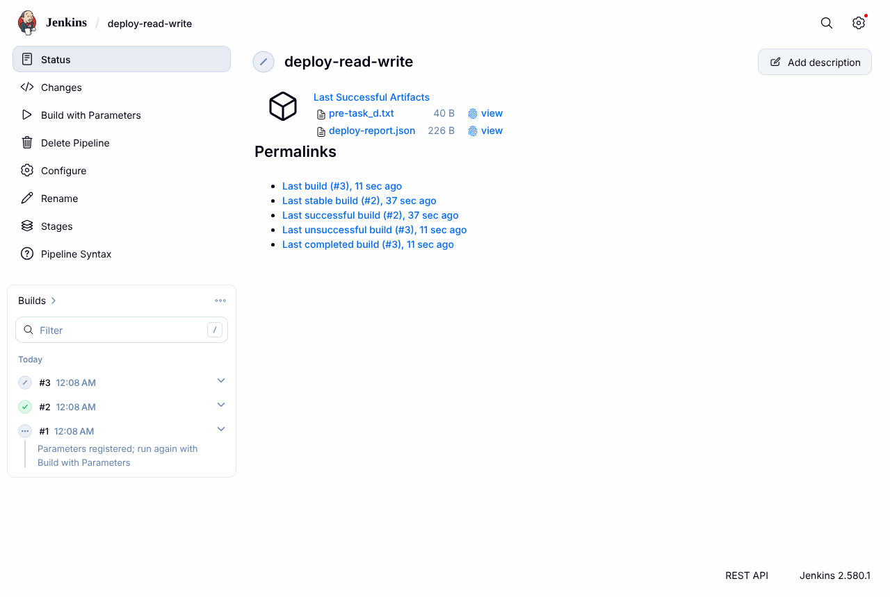

## 谁能点 Run 和 Abort

引擎的 `input` 没有指定 `submitter`。开启了安全设置的 Jenkins 上，有这个 job 的 Job/Build 权限的人能点 **Run** 和 **Abort**，只有 Job/Cancel 权限的人只能点 **Abort**，只能查看的人两个都不能点；Jenkins 管理员都能点。依据和测试范围见 BRIEF.md 的 4.15 节。
