# Jenkins 中途确认：先确认 SQL，再让 Ansible 执行

本目录说明一种做法：流水线执行到某一步后暂停，等指定的人看过要执行的内容（这里是 SQL）并点击确认，然后才继续执行。

- **现状**：`jenkins-ansible-deploy/` 里的部署模板没有这个功能，它的 spec 第 6 节把"人工确认（ask）策略"列为非目标。
- **本目录**：一个独立的 PoC，已经在真实的 Jenkins 上跑通。它还没有并入 `deploy-engine.groovy`（见第 7 节）。
- **用到的机制**：Jenkins 自带的 `input` 步骤（pipeline-input-step 插件），加上 `timeout`、`stash` 和一个 sha256 校验。没有用额外的审批插件。

目录内容：

| 路径 | 内容 |
| --- | --- |
| `examples/Jenkinsfile` | 三个阶段的流水线：Plan → Confirm → Apply |
| `examples/ansible/` | 生成并检查 SQL 的 `plan-sql.yml`；校验后执行 SQL 的 `apply-sql.yml`；模板和两个辅助脚本 |
| `examples/jenkins/security.groovy` | PoC 用的用户和权限配置（`init.groovy.d` 脚本） |
| `screenshots/` | 第 2 节用到的 14 张 Jenkins 截图 |
| `poc/` | 驱动 PoC 的脚本：`drive.py` 通过 REST API 跑各个场景；`screenshots*.py` 用浏览器截图 |

## 1. 机制

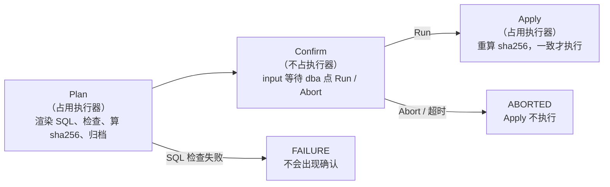

有六个要点：

1. **确认的是最终 SQL。**
   - Plan 阶段由 Ansible 渲染出完整的 `plan/change.sql`。
   - 确认提示里显示的就是这个文件的全文，不是模板，也不是参数。
2. **确认的内容就是执行的内容。**
   - Plan 阶段算出 SQL 的 sha256，写进确认提示。
   - Apply 阶段执行前重新计算，并用 Ansible `assert` 比较。不一致就拒绝执行。
3. **等待时不占执行器。**
   - Confirm 阶段没有 `agent`，所以等待期间不占用任何执行器。
   - Apply 用 `stash`/`unstash` 取回 Plan 的结果，不依赖原来的工作区。
4. **只有指定的人能确认。**
   - `submitter: 'dba'` 规定谁能点 Run。
   - 但它必须配合真正的授权策略才有效（见第 4 节）。
   - `submitterParameter` 记录下实际点击的人。
5. **有超时。**
   - `timeout` 包住 `input`。
   - 无人处理时，构建到时间自动变成 ABORTED，Apply 不执行。
6. **重启不丢。**
   - 等待中的确认会保存在 Jenkins 的构建记录里。
   - Jenkins 重启后，构建继续等待；确认后正常执行。

## 2. UI 流程（截图）

截图来自 PoC 的 Jenkins 2.580.1，界面语言为英文；Jenkins 用中文界面时，按钮和菜单会显示为中文。截图来自三次构建：

| 构建 | SQL 的值 | 结果 |
| --- | --- | --- |
| #9 | `first` | 批准 |
| #10 | `second` | 拒绝 |
| #12 | `third` | 截完图后中止 |

每张图的标题栏都能看到构建号。

### 步骤 1：发起构建

在 **Build with Parameters** 页面填写参数后点击 **Build**。PoC 中的参数是表名、值、数据库文件和确认超时（分钟）。

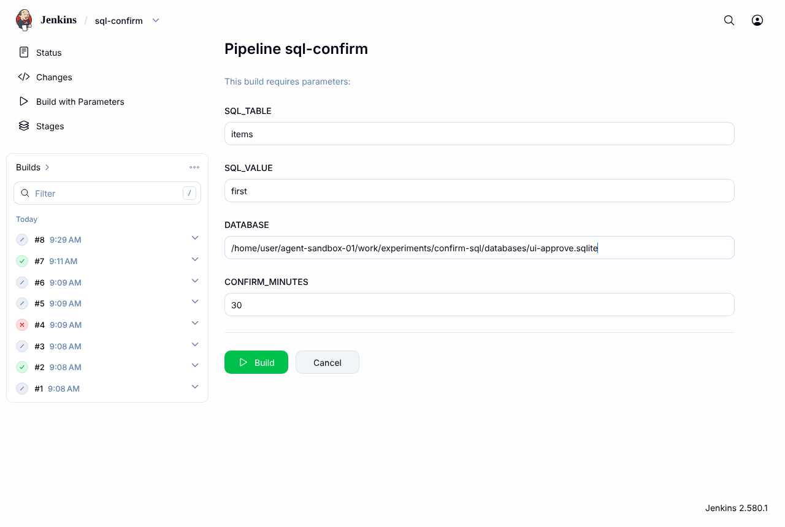

### 步骤 2：构建停在 Confirm，等待确认

Plan 阶段完成后，构建暂停。有三个地方可以看到它在等待。

**构建页面（#9）。** 左侧菜单出现 **Paused for Input**，**Build Artifacts** 下已经有归档的 `change.sql`。进度条一直在走，是因为构建仍处于运行状态。

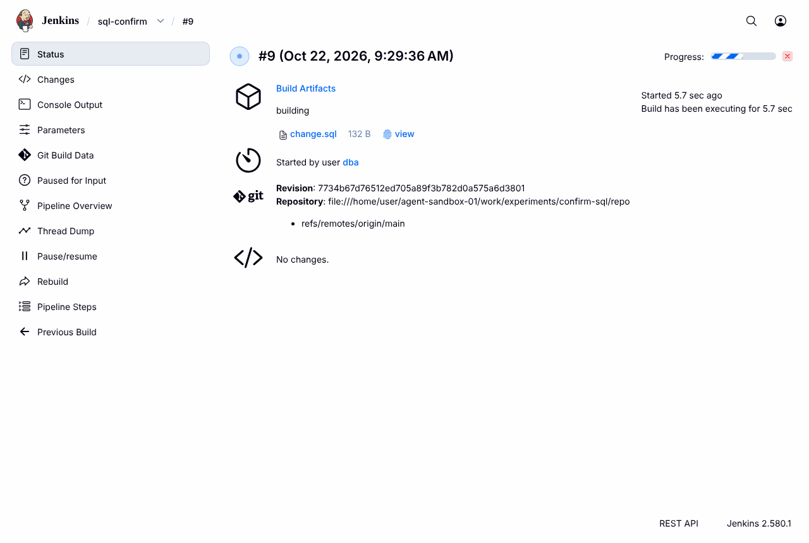

**Stages 页面（#12）。** 也就是左侧菜单里的 **Pipeline Overview**。

- 阶段图中 Plan 已完成，Confirm 显示暂停图标，Apply 还没开始。
- 右侧直接显示确认提示和 **Run** / **Abort** 按钮，不用另开页面。

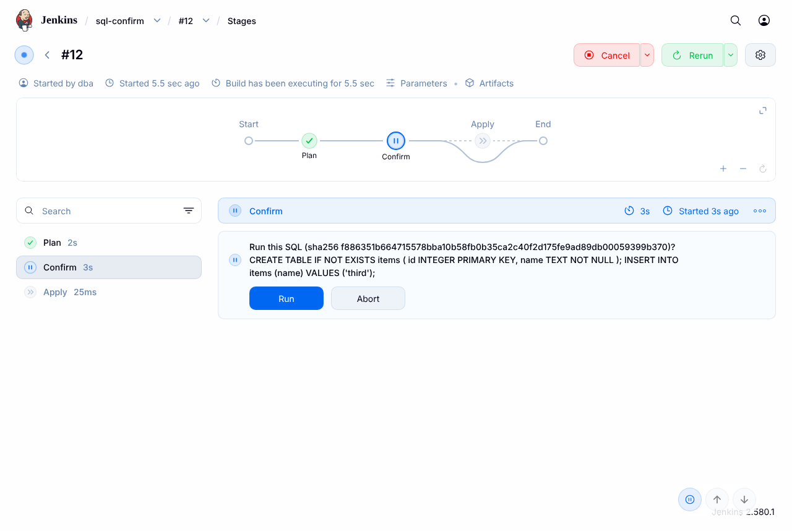

**控制台输出（#12）。** 控制台会打印：

- `Timeout set to expire in 30 min`；
- 完整的确认提示，包括 sha256 和 SQL 原文，换行保留；
- 最后一行 **Run or Abort** 链接。

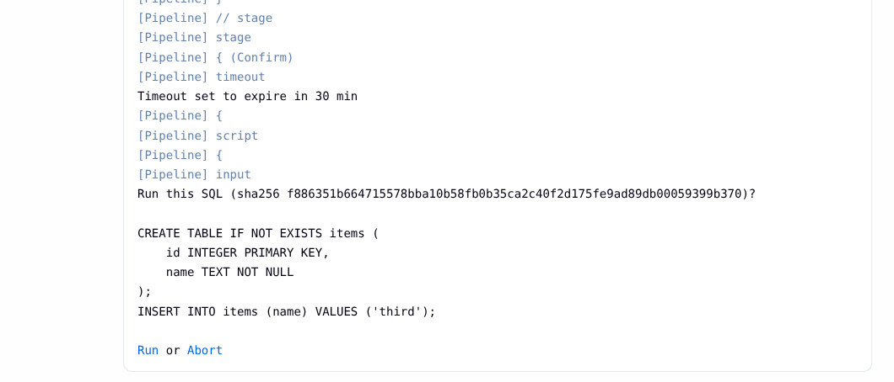

### 步骤 3：审核 SQL

点击 **Paused for Input**，或控制台里的链接，会进入确认页面（#9）。

- 页面标题就是确认提示，**Run** 按钮的文字来自 `ok: 'Run'`。
- 注意：这个页面会把换行折叠成一行，长 SQL 在这里很难读。

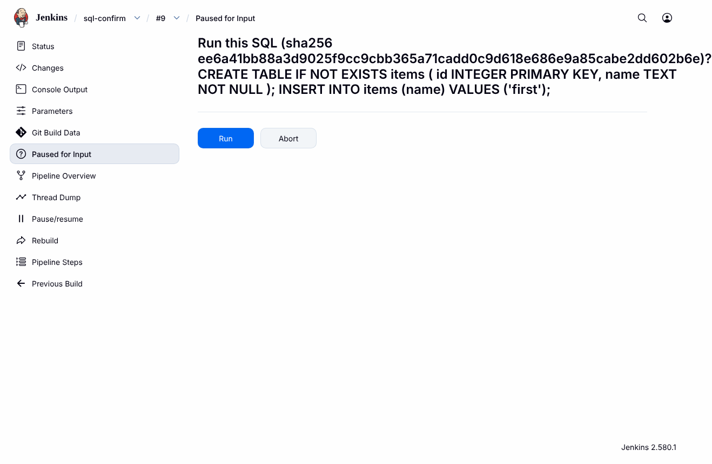

需要仔细看 SQL 时，有两个办法：

- 看控制台（换行保留），或者 Stages 页面中 Confirm 阶段的日志；
- 打开归档的 `change.sql`，也就是构建页面上 `change.sql` 旁边的 **view** 链接。它显示的是文件原文：


### 步骤 4：等待期间不占执行器

构建 #12 正在等待确认时，首页左侧的 **Build Executor Status** 显示 `0/2`：没有执行器被占用。

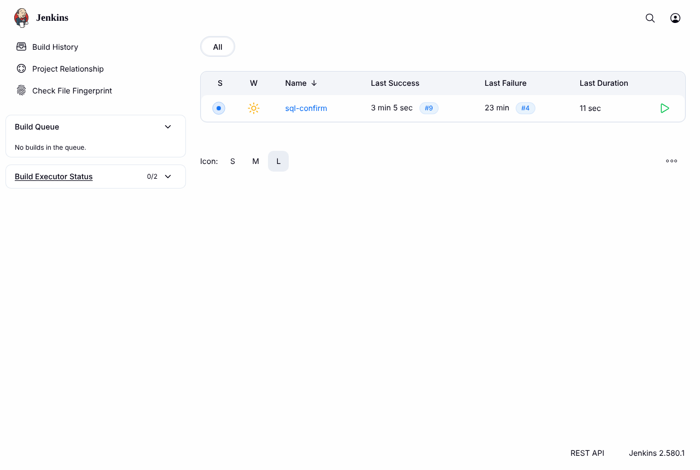

### 步骤 5：没有权限的人点不了

用户 `dev` 能看到构建，也能看到确认页面和按钮：

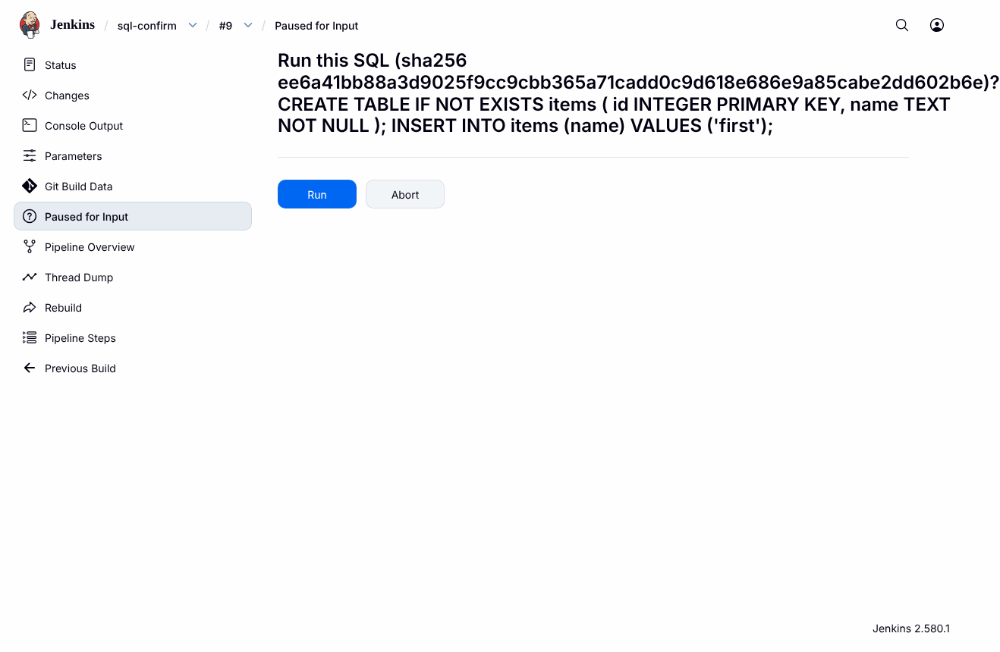

但是点击 **Run** 后，Jenkins 返回错误 **You need to be dba to submit this.**。构建继续等待，数据库没有被创建。通过 REST 实测，`dev` 点 **Abort** 同样被拒绝，因为 `dev` 没有 Job/Cancel 权限（见第 4 节）。

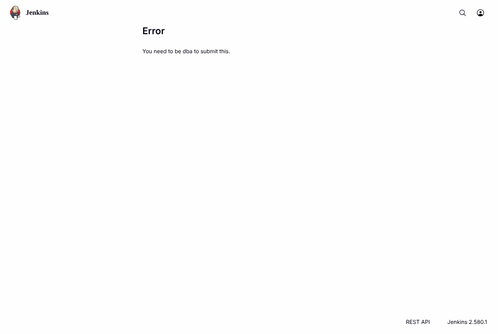

### 步骤 6a：dba 点 Run，批准后执行

**控制台（#9）。** 先显示 `Approved by dba`；流水线收到 `submitterParameter` 返回的用户名，打印 `confirmed by dba`。然后 Apply 阶段运行 `apply-sql.yml`，依次执行三个任务：

1. 重算 SQL 的 sha256；
2. 和确认时的值比较（`Refuse SQL that differs from the confirmed SQL`）；
3. 执行 SQL。

最后构建结果为 `Finished: SUCCESS`。

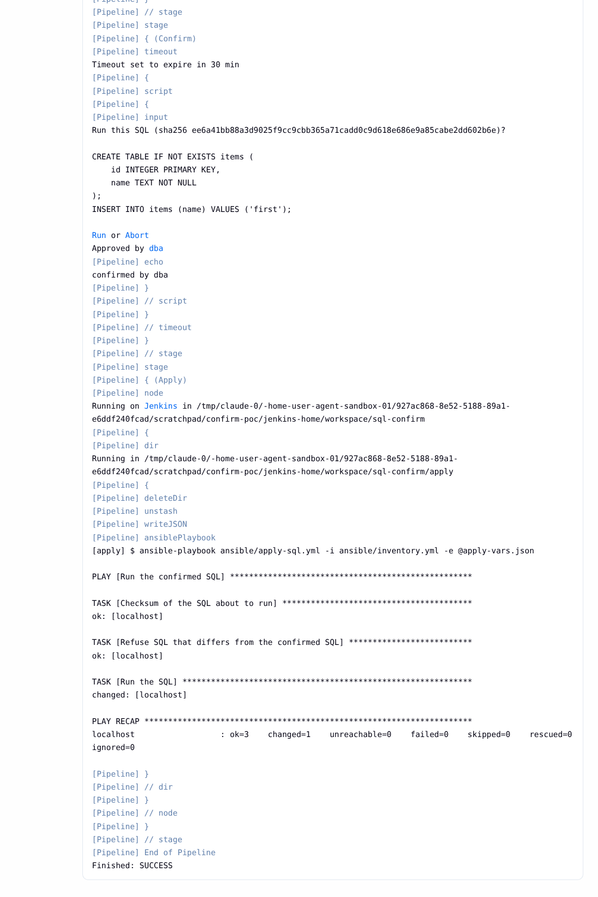

**Stages 页面（#9）。** 三个阶段全部是绿色。

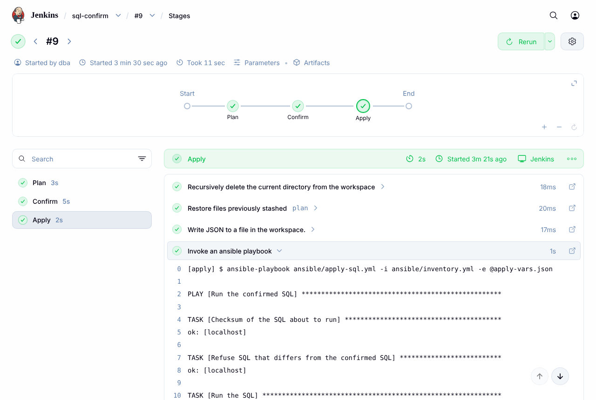

### 步骤 6b：dba 点 Abort，拒绝执行

**控制台（#10）。**

- 显示 `Stage "Apply" skipped due to earlier failure(s)`；
- 显示 `Rejected by dba`；
- 构建结果为 `Finished: ABORTED`。

Apply 没有运行，数据库没有被创建。

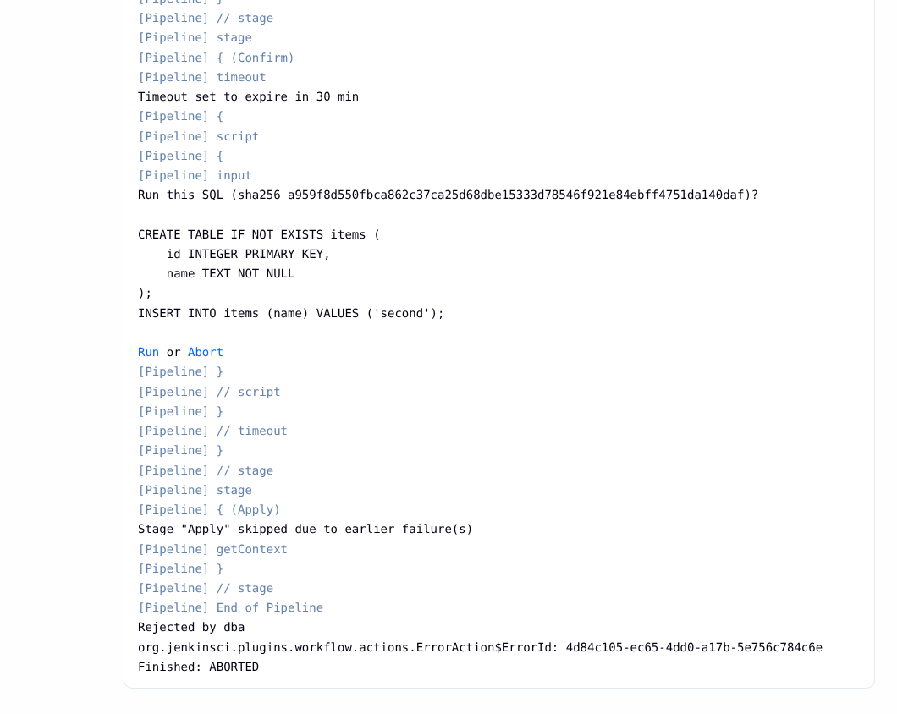

**Stages 页面（#10）。** Confirm 显示为灰色的"已中止"，Apply 显示为跳过。

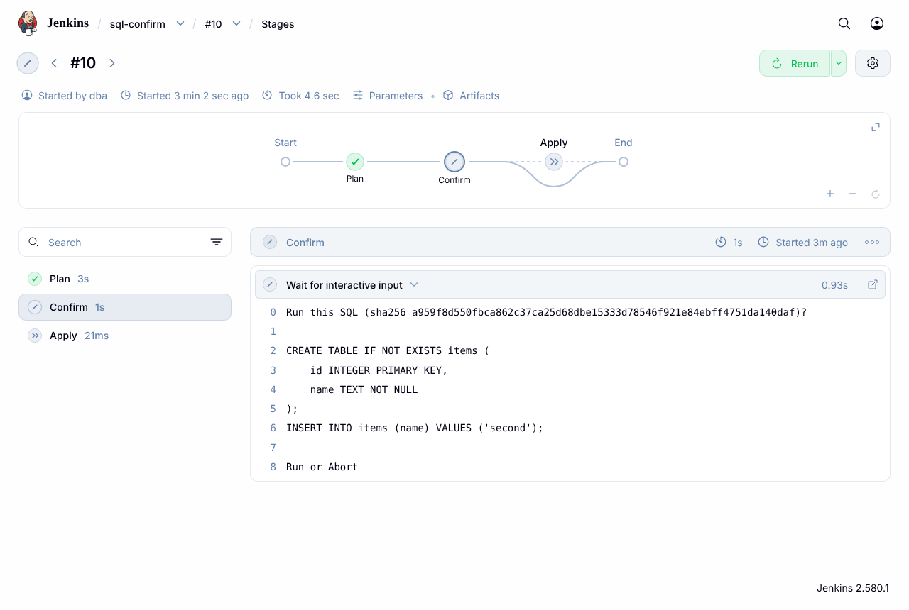

### 步骤 7：构建历史

任务页面的构建历史里，每种结束方式有不同的图标：

- 绿色：批准并执行成功；
- 灰色：被拒绝、超时，或中止；
- 红色：失败。#4 是 SQL 没通过检查，它根本没有进入确认步骤。

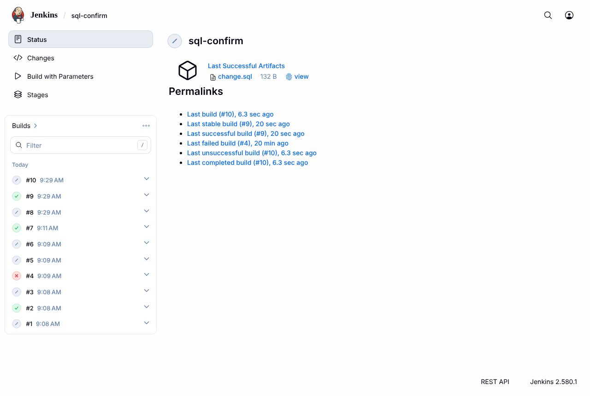

## 3. 实现

### 3.1 Jenkinsfile

完整文件见 `examples/Jenkinsfile`。下面逐段解释关键部分。

#### Plan 阶段

```groovy
stage('Plan') {
    agent any
    steps {
        checkout scm
        writeJSON file: 'plan-vars.json', json: [sql_table: params.SQL_TABLE, sql_value: params.SQL_VALUE]
        ansiblePlaybook playbook: 'ansible/plan-sql.yml', inventory: 'ansible/inventory.yml', extras: '-e @plan-vars.json'
        archiveArtifacts artifacts: 'plan/change.sql'
        script {
            sql = readFile('plan/change.sql')
            planned = readFile('plan/change.sql.sha256').trim()
        }
        stash name: 'plan', includes: 'plan/**,ansible/**'
    }
}
```

- **传参。** 参数先用 `writeJSON` 写进文件，再用 `-e @文件` 传给 Ansible，不用 `extraVars`（原因见第 6 节）。
- **归档。** `archiveArtifacts` 把 SQL 保存为构建产物，审核人可以下载或在线查看，事后也能追溯。
- **记下 SQL 和 sha256。** `sql` 和 `planned` 是 Jenkinsfile 顶层的变量，后面两个阶段都会用到。
- **保存给 Apply。** `stash` 把 SQL 和 playbook 存起来，Apply 阶段可能在另一个节点或另一个工作区运行。

#### Confirm 阶段

```groovy
stage('Confirm') {
    steps {
        timeout(time: params.CONFIRM_MINUTES as int, unit: 'MINUTES') {
            script {
                def approver = input id: 'ConfirmSql', message: "Run this SQL (sha256 ${planned})?\n\n${sql}",
                        ok: 'Run', submitter: 'dba', submitterParameter: 'approver'
                echo "confirmed by ${approver}"
            }
        }
    }
}
```

- **没有 `agent`**：这个阶段不分配执行器，所以等待期间不占资源。
- **`id: 'ConfirmSql'`**：确认的 REST 地址里用这个 id（见第 5 节）。
- **`submitter`**：可以写多个用户或外部组，用逗号分隔，例如 `'dba, alice'`。
- **`submitterParameter`**：让 `input` 返回实际点击 Run 的用户名，可以写进日志或审计记录。
- **`timeout`**：时间一到，`input` 被中断，构建结果为 ABORTED。

#### Apply 阶段

```groovy
stage('Apply') {
    agent any
    options { skipDefaultCheckout() }
    steps {
        dir('apply') {
            deleteDir()
            unstash 'plan'
            writeJSON file: 'apply-vars.json', json: [confirmed_sha256: planned, database: params.DATABASE]
            ansiblePlaybook playbook: 'ansible/apply-sql.yml', inventory: 'ansible/inventory.yml', extras: '-e @apply-vars.json'
        }
    }
}
```

- **不重新检出代码**：`skipDefaultCheckout()` 关掉默认的检出。执行的 SQL 只来自 Plan 阶段 stash 的文件，不会重新生成。
- **干净的目录**：`deleteDir()` 先清空目录，避免工作区里的旧文件混进来。
- **带上确认过的 sha256**：`confirmed_sha256` 是确认时显示的值，交给 Ansible 比较。

### 3.2 Ansible

`plan-sql.yml` 只生成和检查 SQL，不连接目标数据库：

1. 用模板 `change.sql.j2` 渲染出 `plan/change.sql`；
2. 用 `scripts/check_sql.py` 在一个空的内存 SQLite 数据库上试运行一次，语法错误就让构建失败；
3. 用 `stat` 计算 sha256，写入 `plan/change.sql.sha256`。

`apply-sql.yml` 先校验，后执行：

```yaml
- name: Refuse SQL that differs from the confirmed SQL
  ansible.builtin.assert:
    that:
      - about_to_run.stat.exists
      - about_to_run.stat.checksum == confirmed_sha256
    fail_msg: "SQL changed after confirmation: confirmed {{ confirmed_sha256 }}, found {{ about_to_run.stat.checksum | default('no file') }}"
```

只有校验通过，才会运行 `scripts/apply_sql.py`，真正执行 SQL。

### 3.3 权限配置

`examples/jenkins/security.groovy` 是 PoC 的初始化脚本，放在 `$JENKINS_HOME/init.groovy.d/` 下。它做了这些事：

- 创建 `admin`、`dba`、`dev` 三个用户；
- 使用矩阵授权（matrix-auth 插件的 `GlobalMatrixAuthorizationStrategy`）；
- `admin` 有 Overall/Administer 权限；
- `dba` 和 `dev` 都有 Overall/Read、Job/Read、Job/Build 权限；
- 只有 `dba` 有 Job/Cancel 权限。

真实环境中通常已经有授权策略（矩阵授权、基于角色的授权，或者 LDAP 组），按第 4 节的要求检查即可，不需要这个脚本。

## 4. 权限：谁能点 Run，谁能点 Abort

`submitter` 不是单独起作用的。pipeline-input-step 插件的 README 和 `InputStepExecution.java`（第 368 行与第 383 行）规定了以下规则：

| 用户 | 能否 Run | 能否 Abort | 依据 |
| --- | --- | --- | --- |
| 在 `submitter` 中的用户（PoC 中的 `dba`） | 能 | 能 | PoC 实测 |
| 不在 `submitter` 中、没有 Job/Cancel 的用户（PoC 中的 `dev`） | 不能，页面提示 "You need to be dba to submit this."，REST 返回 HTTP 400 | 不能，HTTP 400 | PoC 实测 |
| 不在 `submitter` 中、但有 Job/Cancel 的用户 | 不能 | **能** | 插件 README，PoC 未单独测 |
| Jenkins 管理员（Overall/Administer） | **能，无视 `submitter`** | 能 | 插件 README 与源码，PoC 未单独测 |
| Jenkins 没有开启安全设置时的任何人 | 能 | 能 | 源码 |

由此得出三条要求：

1. **授权策略不能是"登录用户可以做任何事"。**
   - 这种策略下，每个登录用户都是管理员，`submitter` 形同虚设。
   - PoC 第一轮就用的这种策略，结果 `dev` 成功批准了 SQL。这一轮作废，改用矩阵授权后重测。
2. **能确认的人要在 `submitter` 里。** 建议写一个组（例如 LDAP 组），不要写死个人账号。
3. **想阻止别人点 Abort，就不要给他 Job/Cancel 权限。** 管理员总能批准，这一点无法关闭；需要的话，可以依靠 `submitterParameter` 记录下的用户名做事后审计。

## 5. PoC 场景与结果

环境：

| 组件 | 版本 |
| --- | --- |
| Jenkins | 2.580.1（JDK 21） |
| pipeline-input-step | 560.v56198a_642157 |
| pipeline-graph-view（Stages 页面） | 1053.v9df19e6ceed2 |
| matrix-auth | 3.3 |
| ansible 插件 | 635.v34b_48e979c86 |
| pipeline-utility-steps（`writeJSON`） | 3.810.va_7672d206740 |
| ansible-core | 2.21.5 |
| Python | 3.13 |

目标数据库是 SQLite 文件。

| 场景 | 操作 | 结果 |
| --- | --- | --- |
| 批准 | dba 点 Run | SUCCESS。数据库里的数据为 `[(1, 'first')]`，日志中有 `confirmed by dba` |
| 无权限 | dev 通过 REST 分别调用 Run 和 Abort | 都返回 HTTP 400。构建继续等待，数据库没有被创建 |
| 拒绝 | dba 点 Abort | ABORTED，日志中有 `Rejected by dba`。Apply 没有运行，数据库没有被创建 |
| SQL 无效 | 值为 `it's`，渲染出的 SQL 引号不配对 | Plan 阶段的 SQL 检查失败，结果为 FAILURE，不会出现确认步骤 |
| 注入内容 | 值为 `x'); DROP TABLE items; --` | 确认提示原样显示整条语句，包括被注入的 `DROP TABLE`。审核人能看到它，并点了 Abort |
| 超时 | `CONFIRM_MINUTES=1`，无人处理 | 60 秒后 ABORTED，日志中有 `Timeout has been exceeded`。Apply 没有运行 |
| 确认后被改 | 生成 SQL 后修改 `change.sql`，再运行 apply | `assert` 失败：`SQL changed after confirmation: confirmed ee6a41…, found 5a2bdc…`。退出码为 2，数据库没有被创建 |
| 重启 | 等待确认时重启 Jenkins | 重启后日志显示 `Resuming build ... after Jenkins restart`，构建仍在等待。dba 确认后 SUCCESS，数据为 `[(1, 'after restart')]` |
| 资源 | 等待确认时查看执行器 | 忙碌的执行器数为 0（REST 结果，以及第 2 节步骤 4 的截图） |

"确认后被改"是在命令行里直接运行两个 playbook 做的，没有经过 Jenkins。其余场景都由 `poc/drive.py` 通过 Jenkins REST API 完成。

## 6. 陷阱

- **`ansiblePlaybook` 的 `extraVars` 遇到引号会失败。**
  - `extraVars` 会变成 `-e key=value`。值里带单引号时（例如 `it's`），Ansible 报 `failed at splitting arguments`。
  - 解决办法：用 `writeJSON` 写文件，再用 `extras: '-e @file'` 传入。`jenkins-ansible-deploy` 的引擎已经是这么做的。
- **确认页面会把 SQL 折叠成一行。** 审核长 SQL 时，看控制台、Stages 页面或归档的 `change.sql`。
- **确认只能让人看到 SQL，不能挡住注入。**
  - PoC 的模板直接把参数拼进 SQL，注入的语句会原样出现在确认提示里，全靠审核人发现。
  - 真实使用时，应在 Plan 阶段限制参数取值，或改用参数化执行。
- **`input` 不要放在有 `agent` 的阶段里。**
  - 那样等待期间会一直占着执行器（PoC 没有专门测这种写法）。
  - 现有引擎的无插件版本也是在不分配执行器的阶段里调用 `input`。
- **不要让 Apply 重新生成 SQL。**
  - 确认可能等很久，期间代码仓库、模板或参数都可能变化。
  - Apply 只能执行 stash 里那份确认过的文件。sha256 校验是最后一道防线。
- **`executescript` 不是一个事务。**
  - PoC 的 `apply_sql.py` 用的是 SQLite 的 `executescript`，它逐条提交。中途失败时，前面的语句已经生效。
  - 真实数据库应该按自己的事务方式执行。
- **用 REST 新建的任务要先跑一次。** 第一次构建后，Jenkins 才知道 Jenkinsfile 里的参数；在那之前，`buildWithParameters` 用不了。PoC 用一次立即中止的构建完成登记。

## 7. 没有覆盖的部分

- **真实数据库。**
  - PoC 的检查只是在空的内存 SQLite 上试运行，只能发现 SQLite 语法错误。
  - 对 MySQL、PostgreSQL 等，需要换成目标数据库的检查方式，例如在测试库上执行，或者用 `EXPLAIN`。
- **并入现有引擎。** `jenkins-ansible-deploy` 的 `deploy-engine.groovy` 还不支持"某个任务执行前要人工确认"。如果要支持，需要另外设计：
  - 在 `tasks.yml` 里如何声明某个任务需要确认；
  - 确认内容从哪里生成；
  - 和失败策略如何配合。
- **通知。** 等待确认时，没有发送邮件或即时消息通知审核人。
- **多人审批。** 例如需要两个人都同意才能执行。

## 8. 复现

1. 准备 Jenkins，安装第 5 节列出的插件，并安装 Git 插件。
2. 把 `examples/jenkins/security.groovy` 放到 `$JENKINS_HOME/init.groovy.d/`。
   - 它会创建用户，并把 API token 写进 `$JENKINS_HOME/poc-tokens.txt`。
   - 它只适用于测试环境：用户密码是示例值，token 以明文保存。
3. 把 `examples/` 的内容放进一个 git 仓库。
   - 用本地 `file://` 仓库时，Jenkins 需要加启动参数 `-Dhudson.plugins.git.GitSCM.ALLOW_LOCAL_CHECKOUT=true`。
4. 运行驱动脚本。`drive.py` 会创建任务 `sql-confirm`，然后依次跑各个场景：

   ```bash
   CONFIRM_REPO=/path/to/that/repo python3 poc/drive.py "$JENKINS_HOME" approve abort invalid injected timeout restart
   ```

5. 截图（需要 Playwright 和 Chromium）：

   ```bash
   python3 poc/screenshots.py <截图目录> <数据库目录>
   ```

   - `screenshots_extra.py` 补拍裁剪后的控制台、Stages 页面和执行器状态。
   - 它的后两个参数是已批准和已拒绝的构建号。

脚本里的 Jenkins 地址固定为 `http://127.0.0.1:8093`。
