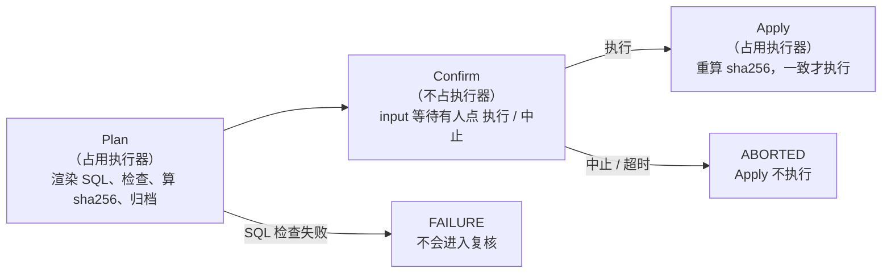
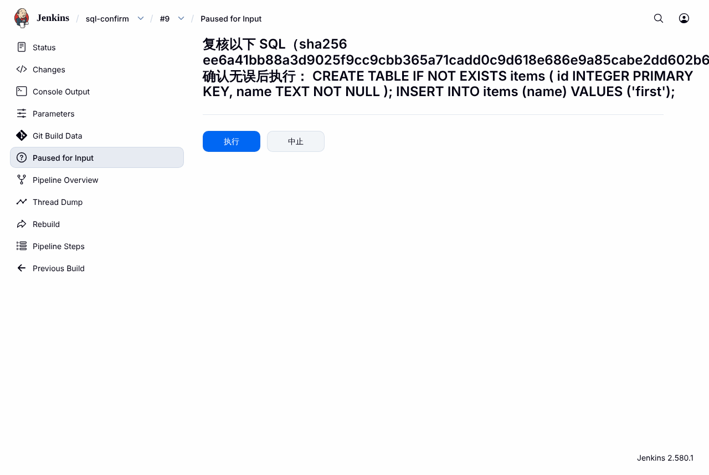
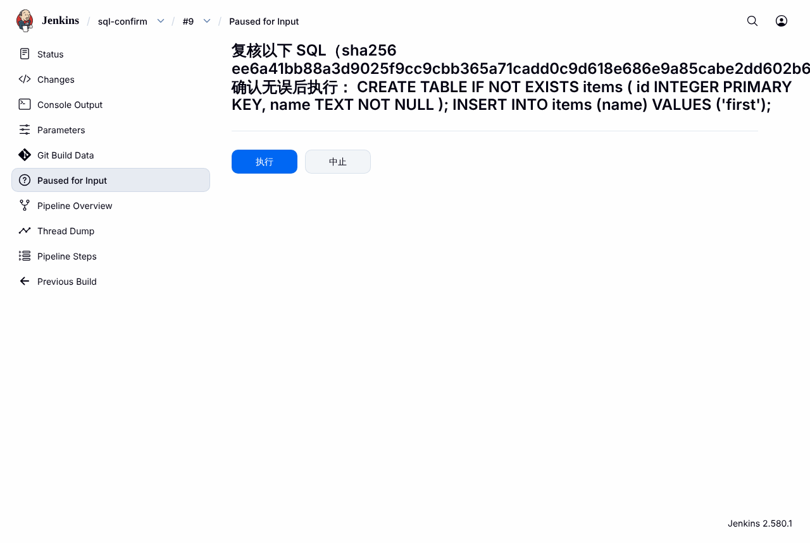
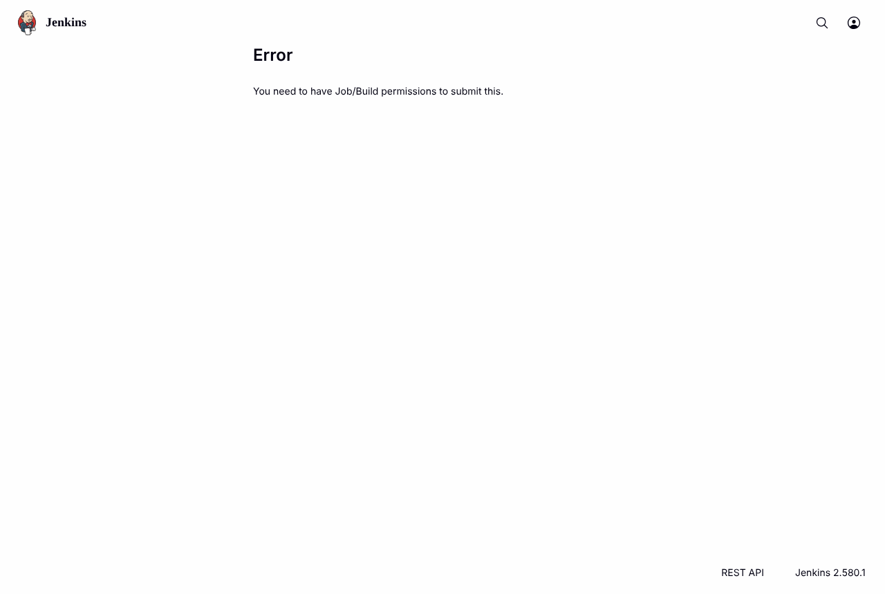
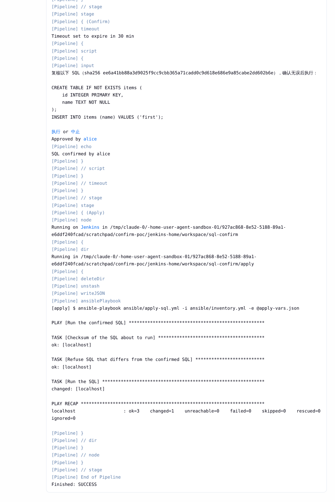
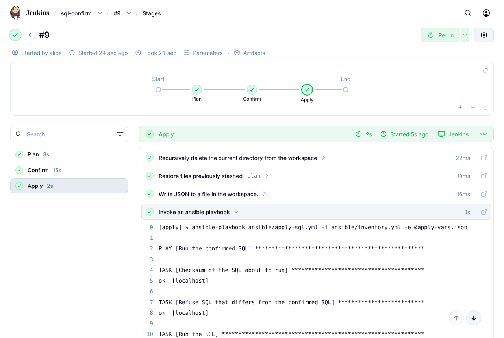

# Jenkins 中途复核：先确认 SQL，再让 Ansible 执行

本目录说明一种做法：流水线执行到某一步后暂停，把即将执行的内容（这里是 SQL）完整地显示出来，由人复核；确认无误点"执行"后才继续，点"中止"则停下。

**目的是复核，不是审批。**
- 能运行这个任务的人，都可以确认或中止，包括发起人自己；
- 不设专门的审批人。

**现状。**
- `jenkins-ansible-deploy/` 里的部署模板没有这个功能，它的 spec 第 6 节把"人工确认（ask）策略"列为非目标。
- 本目录是一个独立的 PoC，已经在真实的 Jenkins 上跑通。
- 它还没有并入 `deploy-engine.groovy`（见第 9 节）。

**用到的机制。**
- Jenkins 自带的 `input` 步骤（pipeline-input-step 插件），加上 `timeout`、`stash` 和一个 sha256 校验；
- 不需要额外的审批插件。

目录内容：

| 路径 | 内容 |
| --- | --- |
| `examples/Jenkinsfile` | 三个阶段的流水线：Plan → Confirm → Apply |
| `examples/ansible/` | `plan-sql.yml`：生成并检查 SQL；`apply-sql.yml`：校验后执行 SQL；另有模板和两个辅助脚本 |
| `examples/jenkins/security.groovy` | PoC 用的用户和权限配置（`init.groovy.d` 脚本） |
| `screenshots/` | 第 2 节用到的 14 张 Jenkins 截图 |
| `poc/` | `drive.py`：通过 REST API 跑第 5 节的各个场景；`screenshots.py`：用浏览器走一遍第 2 节的流程并截图 |

## 1. 机制



有六个要点：

1. **复核的是最终 SQL。**
   - Plan 阶段由 Ansible 渲染出完整的 `plan/change.sql`。
   - 复核提示里显示这个文件的全文，不是模板，也不是参数。
2. **复核的内容就是执行的内容。**
   - Plan 阶段计算 SQL 的 sha256，并写进复核提示。
   - Apply 阶段在执行前重新计算，并用 Ansible `assert` 比较；不一致就拒绝执行。
3. **等待时不占执行器。**
   - Confirm 阶段没有 `agent`。
   - Apply 阶段用 `stash`/`unstash` 取回 Plan 的结果，不依赖原来的工作区。
4. **能运行任务的人都能确认。**
   - `input` 不写 `submitter`，Jenkins 就按任务的"构建"（Job/Build）权限判断谁能点按钮。
   - `submitterParameter` 记下实际点"执行"的人。
5. **有超时。** `timeout` 包住 `input`；没人处理时，构建到时间自动变成 ABORTED，Apply 不执行。
6. **重启不丢。** 等待中的复核保存在构建记录里；Jenkins 重启后构建继续等待，确认后正常执行。

## 2. UI 流程（截图）

截图来自 PoC 的 Jenkins 2.580.1。

**界面语言。**
- Jenkins 自身的界面是英文。
- 复核提示和"执行"/"中止"两个按钮的文字写在 Jenkinsfile 里，所以是中文。

**截图里的用户。**

| 用户 | 权限 |
| --- | --- |
| `alice`、`bob` | 能运行这个任务（Job/Build） |
| `viewer` | 只能查看 |

**截图里的两次构建。**

| 构建 | 发起人 | SQL 的值 | 结果 |
| --- | --- | --- | --- |
| #9 | alice | `first` | alice 自己确认，执行成功 |
| #10 | alice | `second` | bob 中止 |

### 步骤 1：发起构建

在 **Build with Parameters** 页面填写参数后点击 **Build**。PoC 中有四个参数：

- 表名；
- 值；
- 数据库文件；
- 复核超时（分钟）。


### 步骤 2：构建停在 Confirm，等待复核

Plan 阶段完成后，构建会暂停。有三个地方可以看到它在等待。

**构建页面。**
- 左侧菜单出现 **Paused for Input**。
- **Build Artifacts** 下已经有归档的 `change.sql`。
- 进度条一直在走，因为构建仍处于运行状态。


**Stages 页面**（左侧菜单的 **Pipeline Overview**）。
- 阶段图里，Plan 已完成，Confirm 显示暂停图标，Apply 还没开始。
- 右侧直接显示复核提示，以及 **执行** / **中止** 两个按钮，不用另开页面。


**控制台输出。** 依次显示：
- `Timeout set to expire in 30 min`；
- 完整的复核提示，包括 sha256 和 SQL 原文，换行都保留；
- 最后一行是 **执行 or 中止** 两个链接（中间的 "or" 是 Jenkins 固定的文字）。


### 步骤 3：复核 SQL

点击 **Paused for Input** 或控制台里的链接，进入复核页面。

- 页面标题就是复核提示。
- 按钮文字来自 Jenkinsfile 里的 `ok: '执行'` 和 `cancel: '中止'`。
- 注意：这个页面把换行折叠成了一行，sha256 这样的长串还会超出页面右边。长 SQL 在这里很难读。



要仔细看 SQL，可以用这两种方式：
- 看控制台，或 Stages 页面里 Confirm 阶段的日志；
- 打开归档的 `change.sql`（构建页面上 `change.sql` 旁边的 **view**），它显示文件原文：


### 步骤 4：等待期间不占执行器

构建 #9 等待复核时，首页左侧的 **Build Executor Status** 显示 `0/2`，即没有执行器被占用。


### 步骤 5：只能查看的人点不了

`viewer` 能打开复核页面，也能看到按钮：



点 **执行** 后：
- Jenkins 返回 **You need to have Job/Build permissions to submit this.**；
- 构建继续等待，数据库没有被创建。

`viewer` 点 **中止** 同样被拒绝（通过 REST 实测）。



### 步骤 6a：确认后执行

alice 点 **执行**。控制台依次显示：

1. `Approved by alice`，以及流水线打印的 `SQL confirmed by alice`。`Approved by` 是 Jenkins 固定的文字，这里表示"确认人"。
2. Apply 阶段运行 `apply-sql.yml`：
   - 重算 sha256；
   - 和复核时的值比较（`Refuse SQL that differs from the confirmed SQL`）；
   - 执行 SQL。
3. `Finished: SUCCESS`。



Stages 页面上，三个阶段全部是绿色：



第 5 节的场景还验证了另一种情况：alice 发起的构建由 bob 确认，同样能执行，记录的确认人是 bob。

### 步骤 6b：中止

alice 发起构建 #10，bob 点 **中止**。控制台显示：
- `Stage "Apply" skipped due to earlier failure(s)`；
- `Rejected by bob`；
- `Finished: ABORTED`。

Apply 没有运行，数据库也没有被创建。`Rejected by` 同样是 Jenkins 固定的文字。


Stages 页面上，Confirm 显示为灰色的"已中止"，Apply 显示为跳过：


### 步骤 7：构建历史

任务页面的构建历史用颜色区分结果：

- **绿色**：确认后执行成功；
- **灰色**：中止、超时；
- **红色**：失败。#5 是 SQL 没通过检查的那次，根本没有进入复核。

#1 到 #8 是第 5 节各场景留下的构建。


## 3. 实现

### 3.1 Jenkinsfile

完整文件见 `examples/Jenkinsfile`。下面按阶段说明。

#### Plan 阶段

```groovy
stage('Plan') {
    agent any
    steps {
        checkout scm
        writeJSON file: 'plan-vars.json', json: [sql_table: params.SQL_TABLE, sql_value: params.SQL_VALUE]
        ansiblePlaybook playbook: 'ansible/plan-sql.yml', inventory: 'ansible/inventory.yml', extras: '-e @plan-vars.json'
        archiveArtifacts artifacts: 'plan/change.sql'
        script {
            sql = readFile('plan/change.sql')
            planned = readFile('plan/change.sql.sha256').trim()
        }
        stash name: 'plan', includes: 'plan/**,ansible/**'
    }
}
```

- **传参。** 参数先用 `writeJSON` 写进文件，再用 `-e @文件` 交给 Ansible，而不是用 `extraVars`（原因见第 7 节）。
- **归档。** `archiveArtifacts` 把 SQL 保存成构建产物。复核时可以在线查看，事后也能追溯。
- **记下内容。** `sql` 和 `planned` 是 Jenkinsfile 顶层的变量，分别记住 SQL 原文和它的 sha256，后面两个阶段都要用。
- **暂存结果。** `stash` 把 SQL 和 playbook 存起来，因为 Apply 可能在另一个节点或另一个工作区运行。

#### Confirm 阶段

```groovy
stage('Confirm') {
    steps {
        timeout(time: params.CONFIRM_MINUTES as int, unit: 'MINUTES') {
            script {
                // No submitter: anyone allowed to build this job can confirm or abort
                def confirmedBy = input id: 'ConfirmSql', message: "复核以下 SQL（sha256 ${planned}），确认无误后执行：\n\n${sql}",
                        ok: '执行', cancel: '中止', submitterParameter: 'confirmedBy'
                echo "SQL confirmed by ${confirmedBy}"
            }
        }
    }
}
```

- **没有 `agent`。** 等待期间不占执行器。
- **没有 `submitter`。** 谁能点按钮由任务的构建权限决定（见第 4 节）。
- **`id: 'ConfirmSql'`。** 复核的 REST 地址里用这个 id：`/job/<任务>/<构建号>/input/ConfirmSql/proceedEmpty` 是执行，`.../abort` 是中止。
- **`ok` / `cancel`。** 两个按钮上的文字。
- **`submitterParameter`。** `input` 会返回确认人的用户名，可以写进日志或审计记录。
- **`timeout`。** 只包住等待这一段；时间一到，构建结果为 ABORTED。

#### Apply 阶段

```groovy
stage('Apply') {
    agent any
    options { skipDefaultCheckout() }
    steps {
        dir('apply') {
            deleteDir()
            unstash 'plan'
            writeJSON file: 'apply-vars.json', json: [confirmed_sha256: planned, database: params.DATABASE]
            ansiblePlaybook playbook: 'ansible/apply-sql.yml', inventory: 'ansible/inventory.yml', extras: '-e @apply-vars.json'
        }
    }
}
```

- **不重新检出，不重新生成。** 执行的 SQL 只来自 Plan 阶段 stash 的那份文件。
- **先清空目录。** `deleteDir()` 防止工作区里的旧文件混进来。
- **带上复核时的 sha256。** `confirmed_sha256` 就是复核提示里显示的那个值，交给 Ansible 比较。

### 3.2 Ansible

`plan-sql.yml` 只生成和检查 SQL，不连接目标数据库：

1. 用模板 `change.sql.j2` 渲染出 `plan/change.sql`；
2. 用 `scripts/check_sql.py` 在空的内存 SQLite 上试运行；有语法错误时，构建失败；
3. 用 `stat` 计算 sha256，写入 `plan/change.sql.sha256`。

`apply-sql.yml` 先校验，后执行：

```yaml
- name: Refuse SQL that differs from the confirmed SQL
  ansible.builtin.assert:
    that:
      - about_to_run.stat.exists
      - about_to_run.stat.checksum == confirmed_sha256
    fail_msg: "SQL changed after confirmation: confirmed {{ confirmed_sha256 }}, found {{ about_to_run.stat.checksum | default('no file') }}"
```

只有校验通过，才会运行 `scripts/apply_sql.py` 执行 SQL。

### 3.3 权限配置

`examples/jenkins/security.groovy` 是 PoC 的初始化脚本，放在 `$JENKINS_HOME/init.groovy.d/` 下。它做了这些事：

- 创建 `admin`、`alice`、`bob`、`viewer` 四个用户；
- 使用矩阵授权（matrix-auth 插件的 `GlobalMatrixAuthorizationStrategy`）；
- `admin`：系统管理权限；
- `alice`、`bob`：Overall/Read、Job/Read、Job/Build；
- `viewer`：只有 Overall/Read、Job/Read；
- 所有人都没有 Job/Cancel。

真实环境通常已有授权配置，不需要这个脚本。只要按第 4 节确认"谁有这个任务的构建权限"即可。

## 4. 权限：谁能点"执行"和"中止"

不写 `submitter` 时，判断规则来自 pipeline-input-step 插件源码（`InputStepExecution.java` 第 368 行和第 381 行）：

| 用户 | 能否"执行" | 能否"中止" | 依据 |
| --- | --- | --- | --- |
| 有这个任务的 Job/Build 权限（alice、bob） | 能，不论是不是发起人 | 能 | PoC 实测 |
| 只能查看（viewer） | 不能：页面提示 "You need to have Job/Build permissions to submit this."，REST 返回 HTTP 400 | 不能：HTTP 400 | PoC 实测 |
| 没有 Job/Build，但有 Job/Cancel | 不能 | 能 | 源码，PoC 未测 |
| Jenkins 管理员 | 能 | 能 | 源码，PoC 未测 |
| Jenkins 没有开启安全设置时的任何人 | 能 | 能 | 源码 |

所以只需要保证一件事：**能运行这个任务的人，就是可以复核的人。**

这正是复核需要的效果，不必再配置别的。

以后如果要改成"只有指定的人才能确认"，在 `input` 里加上 `submitter: '用户或组'` 就行。但要注意：管理员不受 `submitter` 限制。

## 5. PoC 场景与结果

环境：

| 组件 | 版本 |
| --- | --- |
| Jenkins | 2.580.1（JDK 21） |
| pipeline-input-step | 560.v56198a_642157 |
| pipeline-graph-view（Stages 页面） | 1053.v9df19e6ceed2 |
| matrix-auth | 3.3 |
| ansible 插件 | 635.v34b_48e979c86 |
| pipeline-utility-steps（`writeJSON`） | 3.810.va_7672d206740 |
| ansible-core | 2.21.5 |
| Python | 3.13 |

目标数据库是 SQLite 文件。除"确认后被改"外，所有构建都由 alice 通过 REST 发起。

| 场景 | 操作 | 结果 |
| --- | --- | --- |
| 发起人自己确认 | alice 点"执行" | SUCCESS。数据为 `[(1, 'first')]`；日志有 `Approved by alice` 和 `SQL confirmed by alice` |
| 只读用户 | viewer 分别点"执行"和"中止" | 都返回 HTTP 400。构建继续等待，数据库没有被创建 |
| 别人确认 | bob 确认 alice 发起的构建 | SUCCESS。数据为 `[(1, 'confirmed by someone else')]`；日志有 `SQL confirmed by bob` |
| 中止 | bob 中止 alice 发起的构建 | ABORTED，日志有 `Rejected by bob`。Apply 没有运行，数据库没有被创建 |
| SQL 无效 | 值为 `it's`，渲染出的 SQL 引号不配对 | Plan 阶段的检查失败，结果 FAILURE，不会进入复核 |
| 注入内容 | 值为 `x'); DROP TABLE items; --` | 复核提示原样显示整条语句，包括被注入的 `DROP TABLE`，复核人能看到；随后点了中止 |
| 超时 | `CONFIRM_MINUTES=1`，无人处理 | 61 秒后 ABORTED，日志有 `Timeout has been exceeded`。Apply 没有运行 |
| 确认后被改 | 生成 SQL 后修改 `change.sql`，再运行 apply | `assert` 失败：`SQL changed after confirmation: confirmed ee6a41…, found 5a2bdc…`。退出码 2，数据库没有被创建 |
| 重启 | 等待复核时重启 Jenkins | 重启后日志显示 `Resuming build ... after Jenkins restart`，构建仍在等待。确认后 SUCCESS，数据为 `[(1, 'after restart')]` |
| 资源 | 等待复核时查看执行器 | 忙碌的执行器数为 0（REST 返回的结果，以及第 2 节步骤 4 的截图） |

**说明：**
- "确认后被改"不经过 Jenkins，由 `drive.py` 的 `tamper` 场景直接调用两个 playbook 完成。
- 其余场景都由 `drive.py` 通过 Jenkins REST API 完成。

## 6. 版本要求

这套做法本身对版本要求很低。用到的功能最早从以下版本开始可用（来自各插件的 CHANGELOG）：

| 用到的功能 | 所在插件 | 最早版本 |
| --- | --- | --- |
| `input` 的 `submitterParameter`；`input` 可以被 `timeout` 中断 | pipeline-input-step | 2.5（2016-11） |
| `input` 的 `ok`、`cancel` 按钮文字 | pipeline-input-step | 插件 README 的写法；最早版本未查 |
| stage 级 `options { skipDefaultCheckout() }`、stage 级 `agent` | pipeline-model-definition（声明式流水线） | 1.2.6（2018-01） |
| `writeJSON` | pipeline-utility-steps | 1.3.0（2017-03） |
| `stash`/`unstash`、等待时不占执行器、重启后继续等待 | Pipeline 核心插件 | 一直都有 |

**结论：**
- 2018 年以后、带 Pipeline 的 Jenkins 2.x，原则上都能用。
- 但只在 2.580.1 上实测过。
- PoC 装的都是最新插件，它们要求 Jenkins 核心不低于 2.568.1（要求最高的是 workflow-job）。在旧版 Jenkins 上，插件管理器会装与之兼容的旧版插件；机制相同，但没有实测。

**界面：**
- 带内嵌按钮的 Stages 页面来自 pipeline-graph-view 插件。PoC 装的这个版本要求核心不低于 2.555.3。
- 没有这个插件也不影响功能：构建页的 **Paused for Input**、复核页面、控制台链接都是 Jenkins 自带的。

## 7. 陷阱

- **`ansiblePlaybook` 的 `extraVars` 遇到引号会失败。**
  - `extraVars` 会变成 `-e key=value`。值里带单引号时（如 `it's`），Ansible 报 `failed at splitting arguments`。
  - 解决办法：用 `writeJSON` 写文件，再用 `extras: '-e @file'` 传入。`jenkins-ansible-deploy` 的引擎也是这样做的。
- **复核页面会把 SQL 折叠成一行。** 复核长 SQL 时，看控制台、Stages 页面或归档的 `change.sql`。
- **复核只能让人看到 SQL，挡不住注入。**
  - PoC 的模板直接把参数拼进 SQL。注入的语句会原样出现在提示里，能不能拦下全靠复核人。
  - 真实使用时，应在 Plan 阶段限制参数的取值，或者改用参数化执行。
- **`input` 不要放在有 `agent` 的阶段里。**
  - 否则等待期间会一直占着执行器（PoC 没有专门测这种写法）。
  - 现有引擎的无插件版也是在不分配执行器的阶段里调用 `input`。
- **不要让 Apply 重新生成 SQL。**
  - 复核可能要等一段时间，期间代码、模板或参数都可能变化。
  - Apply 只执行 stash 里那份复核过的文件；sha256 校验是最后一道防线。
- **`executescript` 不是一个事务。**
  - PoC 的 `apply_sql.py` 用 SQLite 的 `executescript` 逐条提交；中途失败时，前面的语句已经生效。
  - 真实数据库应按自己的事务方式执行。
- **用 REST 新建的任务要先跑一次。**
  - 第一次构建之后，Jenkins 才知道 Jenkinsfile 里定义的参数；在那之前不能用 `buildWithParameters`。
  - PoC 用一次立即中止的构建来登记参数。

## 8. 为什么用 `input`

可以考虑的做法有五种：

| 做法 | 结论 |
| --- | --- |
| 在同一次构建里用 `input` 暂停（本方案） | 复核是一次操作中间的一步。确认的内容、确认人和执行结果都在同一条构建记录里 |
| 声明式流水线 stage 上的 `input` 指令 | 机制相同；但复核提示要用到运行时生成的 SQL，超时也只应限制等待时间。这两点在指令写法下没有验证，所以用了 `script` 中的 `input` 步骤 |
| 拆成"生成"和"执行"两个任务 | 两次构建要自己关联，不符合"一次操作中途复核"的用法 |
| Ansible 的 `pause` | Jenkins 里没有交互终端，不可行 |
| 把复核提前到代码评审 | 只适用于 SQL 事先写好的情况。这里的 SQL 是运行时由参数渲染的，评审时看不到最终语句 |

此外，`input` 是 Pipeline 自带的步骤：
- 现有的 `deploy-engine.groovy` 已经在用它填写任务参数，并入时不需要新插件；
- 每个复核都有固定的 REST 地址，以后也能从别的工具里点"执行"。

## 9. 没有覆盖的部分

- **真实数据库。**
  - PoC 只在空的内存 SQLite 上试运行，只能发现 SQLite 的语法错误。
  - MySQL、PostgreSQL 等需要换成目标数据库的检查方式，例如在测试库上执行，或者用 `EXPLAIN`。
- **并入现有引擎。** `deploy-engine.groovy` 还不支持"某个任务执行前要复核"。需要设计：
  - 在 `tasks.yml` 里如何声明这一点；
  - 复核内容从哪里生成；
  - 复核和失败策略如何配合。
- **通知。** 等待复核时，不会发邮件或即时消息提醒。

## 10. 复现

1. 准备 Jenkins，安装第 5 节列出的插件和 Git 插件。
2. 把 `examples/jenkins/security.groovy` 放到 `$JENKINS_HOME/init.groovy.d/`。
   - 它会创建四个用户，并把 API token 写进 `$JENKINS_HOME/poc-tokens.txt`。
   - 只适用于测试环境：密码是示例值，token 以明文保存。
3. 把 `examples/` 的内容放进一个 git 仓库。用本地 `file://` 仓库时，Jenkins 需要加启动参数 `-Dhudson.plugins.git.GitSCM.ALLOW_LOCAL_CHECKOUT=true`。
4. 运行场景。`drive.py` 会创建任务 `sql-confirm`，然后依次运行各场景：

   ```bash
   CONFIRM_REPO=/path/to/that/repo python3 poc/drive.py "$JENKINS_HOME" self other abort invalid injected timeout tamper restart
   ```

5. 截图（需要 Playwright 和 Chromium）：

   ```bash
   python3 poc/screenshots.py <截图目录> <数据库目录>
   ```

脚本里的 Jenkins 地址固定为 `http://127.0.0.1:8093`。
