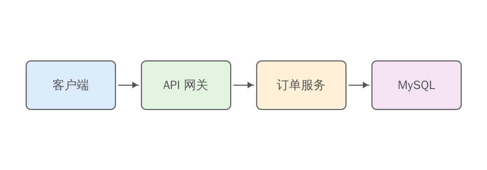

# 总体架构

系统采用分层架构，请求经网关路由到订单服务，再落库到 MySQL：

| 组件 | 职责 | 技术选型 |
|------|------|:--------:|
| API 网关 | 鉴权、限流、路由 | Spring Cloud Gateway |
| 订单服务 | 下单、状态机、事件发布 | Spring Boot 3 |
| MySQL | 订单与流水存储，按用户 ID 分 16 库 | MySQL 8.4 |

部署要点：

1. 订单服务无状态，按 CPU 水位自动扩缩容
2. 数据库主从部署
   - 主库承担写入
   - 从库承担查询，延迟告警阈值 1 s
3. 所有服务接入统一链路追踪[^1]

[^1]: 这里的脚注编号与《项目概述》中的 `[^1]` 相同，但会被渲染为两个独立的脚注。
